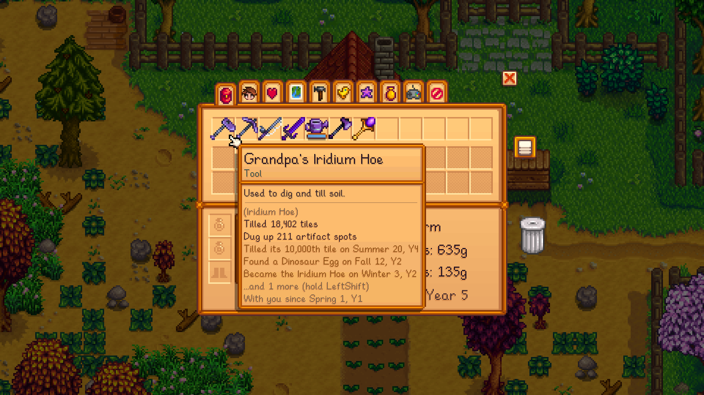

# Heirloom Tools

A Stardew Valley 1.6 mod. Every tool and weapon quietly keeps a lifetime record of how you used it. Hover over it to read its story:

> **Grandpa's Iridium Hoe**
> Tilled 18,402 tiles
> Dug up 211 artifact spots
> Tilled its 10,000th tile on Summer 20, Y4
> Found a Dinosaur Egg on Fall 12, Y2
> With you since Spring 1, Y1

## Features
- **Lifetime stats for every tool and weapon.** The record lives on the tool itself, so it moves with it through chests, upgrades and multiplayer trades.

  | Tool | What it remembers |
  |---|---|
  | Hoe | tiles tilled, artifact spots dug |
  | Watering can | tiles watered, refills |
  | Pickaxe | rocks broken, geodes turned up |
  | Axe | trees felled, stumps cleared |
  | Fishing rod | fish caught, perfect catches, treasure chests, trash, biggest catch |
  | Swords, daggers, clubs, slingshots | monsters slain, the monster you've slain most, weeds cleared |
  | Scythe | grass cut, weeds cleared |
  | Pan, milk pail, shears, Return Scepter | times used |

- **Moments.** Rare finds (Prismatic Shards, Dinosaur Eggs, Strange Dolls, Golden Masks, Pearls and more), each tool's first artifact and first fish, legendary fish, milestones (100, 1,000, 10,000 and so on) and Clint's upgrades are written into the tool's history with the date. The tooltip shows the latest three. Hold **Left Shift** to see them all.
- **Name your tools.** Press **N** while holding a tool, or while hovering over one in your inventory, to give it a name like *Grandpa's Iridium Hoe*. To go back to the usual name, enter the tool's usual name.
- **Milestone messages.** You get a message when a tool reaches a milestone, like *Your Iridium Pickaxe just broke its 50,000th rock!*
- **Works on existing saves.** The first time you load a save, every tool you own is marked "Remembered since" that day. The best tool of each kind you're carrying gets the farm's lifetime totals from the game's own stats (tiles hoed, rocks crushed, trees chopped, fish caught, times panned), so your old pickaxe can show off right away.
- Upgrades at Clint keep the whole record.
- Generic Mod Config Menu support, and console commands.

## Install
1. Install [SMAPI](https://smapi.io) 4.0 or later.
2. Unzip the mod into `Stardew Valley/Mods`.
3. Optionally install [Generic Mod Config Menu](https://www.nexusmods.com/stardewvalley/mods/5098) to change settings in-game.

The mod can be added to or removed from a save at any time. If it's removed, the records stay hidden in the tools' save data and come back if you reinstall it.

## Config
| Setting | Default | What it does |
|---|---|---|
| `ShowInTooltip` | `true` | Add each tool's record to its tooltip. |
| `MomentsShown` | `3` | How many recent moments the tooltip shows. |
| `ExpandKey` | `LeftShift` | Hold to see all of a tool's moments. |
| `RenameKey` | `N` | Name the tool you're holding or hovering over. |
| `ShowNicknames` | `true` | Show tool names in place of the usual names. |
| `MilestoneMessages` | `true` | Show a message when a tool reaches a milestone. |
| `BackfillFromGameStats` | `true` | On an existing save, fill in your tools' totals from the farm's stats. |

## Console commands
- `heirloom_show`: print the record of every tool in your inventory, for sharing.
- `heirloom_name [name]`: name the tool you're holding (no name clears it).
- `heirloom_reset`: erase the record of the tool you're holding.

## Compatibility
- Stardew Valley 1.6+, SMAPI 4.0+. Works in single player, multiplayer and split-screen. Each player's tools count only their own work.
- Uses Harmony postfixes only, so it shouldn't conflict with other mods. Tools from other mods are tracked if they're built on the vanilla tool types.

## License
MIT. See [LICENSE](LICENSE).
